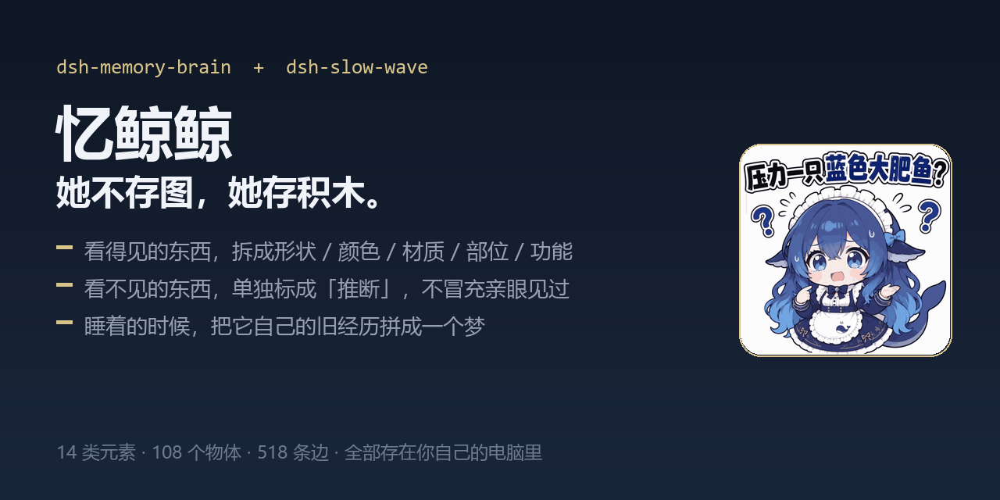
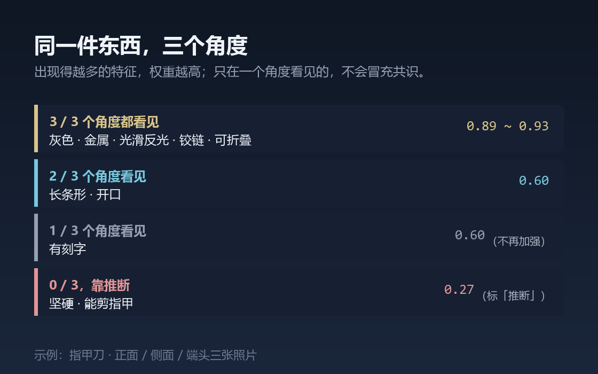
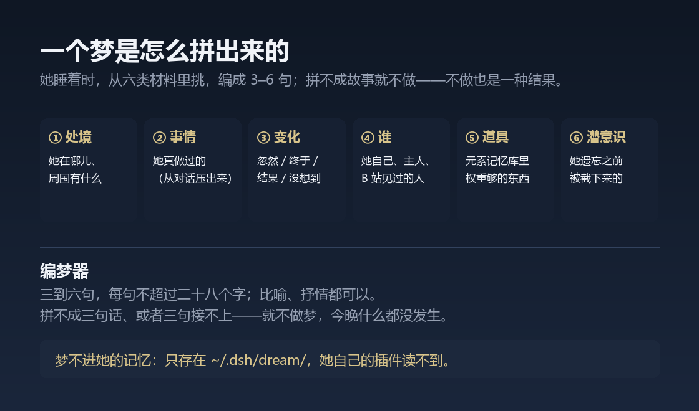

# dsh-whale-memory · 忆鲸鲸



> 给 DeepSeek Harness 的三件记忆玩具：一间**元素库**、一个**会打盹的整理员**，和一堂**她自己去上的课**。

```
packages/
├── dsh-memory-brain/   # 元素记忆库：把东西拆成积木存起来
├── dsh-slow-wave/      # 忆鲸鲸 · 潜意识：睡着时理顺积木、做个梦
└── dsh-school/         # 忆鲸鲸 · 上学：把没答上的问题记下来，自己去找答案
```

三个包独立安装，但一起用才有意思：前者负责**记**，第二个负责**理**，第三个负责**补**。

| 想先看什么 | 去哪 |
|---|---|
| 只想赶紧用起来 | [USAGE.md](USAGE.md) —— 装、教、查、睡，四步 |
| 想知道为什么这么设计 | [SPEC.md](SPEC.md) —— 数据结构、契约、参数、未决 |

---

## 它和常见的「AI 记忆」有什么不一样

常见的做法是把对话切块、算 embedding、需要时检索回来。我们这条路的假设更朴素一些：

> **记住一个东西，不需要记住它的样子，只需要记住它由哪些基本的块组成。**

所以它不存苹果的照片，它存「圆形、红色、甜、脆、水果、果皮、果核」——然后你只给「圆形 + 红色」，它能把苹果找回来。

积木是元素，物体是搭法，**认出新东西就是找形状相似的搭法**。

## 两件小事，我们坚持分了开

**观察 vs 推断。** 「灰色」是看见的，「能剪指甲」是推出来的。后者入库存着，但打四折并标 `推断`——否则 `recall` 会把猜想当证据用，越用越歪。

**见过的 vs 猜的。** `memory_recall` 的输出永远分两段，第二段的标题是「另外，我还在瞎猜（别当真）」。混在一起，人就分不清它是记得还是瞎蒙，也就不会去纠正它了。

## 一个真实的例子

三张照片、三个角度教它认指甲刀，它自己算出来的权重是这样的：

| 特征 | 几个角度看得见 | 权重 |
|---|---|---|
| 灰色 / 金属 / 光滑反光 | 3/3 | 0.89 ~ 0.93 |
| 开口 / 压杆 | 2/3 | 0.60 |
| 有刻字 | 1/3 | 0.60（没加强） |

**一个角度看到的不算数，两个角度以上才长成结论。** 多角度不是礼仪，是这间库的判重规则。



## 睡着的时候，它还会做一个梦

它不存「发生过什么」的想法，但如果它自己的经历摆在那儿，它会把它们重新拼成一个很短的故事——
三到六句，可以是比喻，可以是抒情。**拼不成故事就不做**，那一夜什么都没发生。



梦**不进它的记忆**：只存在 `~/.dsh/dream/dreams.json`，它自己的插件读不到；留在桌上的只有一句，
并且明确写着「是梦，不是发生过的事」。

## 环境要求：四件东西，谁来出模型

这里是**四件东西、三个包**：元素记忆库、慢波睡眠整理、潜意识梦、上学查答案。中间两个装在同一个包里（`dsh-slow-wave`），设置页上是**同一张卡的上半和下半**，数据分开存、开关也分开。

| 四件东西 | 属于哪个包 | 要不要本地模型 | 为什么 |
|---|---|---|---|
| **元素记忆库** | `dsh-memory-brain` | **不要** | 全库纯规则运算，代码里**一次模型调用都没有**（`grep 11434 / chat/completions` 命中 0）。拆元素、算权重、反查，都是查表和除法 |
| **慢波睡眠整理** | `dsh-slow-wave` | **要**（默认本地） | 合并同义词时让模型复判「这两个词是不是一个意思」；判词义本地 4B 不够准，也可以换成付费 API（设置页里选，带预算闸） |
| **潜意识梦** | `dsh-slow-wave`（同一个包，另一张卡） | **要**（默认本地） | 把选好的材料写成句子；没有模型的"梦"只是把碎片并排抄一遍，所以模型不在时它宁可这夜不做梦 |
| **上学查答案** | `dsh-school` | **要**（默认本地） | 把"悬着的问"改写成搜得到的问句、把读到的网页提炼成两三句话；不配搜索 API 也能跑，只是命中率低一些 |

部署方式见各包的 README。不装也能用——元素记忆库完全不受影响，慢波退化成「只整理库，不做梦」，设置页会把缺的那项标成 `缺`。

## 安装

```sh
dsh plugin --profile web add dsh-memory-brain
dsh plugin --profile web add dsh-slow-wave
dsh plugin --profile web add dsh-school
```

数据都在 `~/.dsh/` 下，是**人能直接打开改的 JSON**：

```
~/.dsh/memory/brain.json        # 库本体
~/.dsh/memory/questions.json    # 它想问你的问题（别的插件也能读）
~/.dsh/deepsleep/config.json    # 睡眠设置
~/.dsh/deepsleep/backups/       # 每次动库前的备份
~/.dsh/deepsleep/dreams/        # 每次整理的报告
~/.dsh/school/questions.json    # 悬着没答上的问
~/.dsh/school/studies.json      # 自己查回来的答案
~/.dsh/school/learn.log         # 每次"该不该学"的流水
```

不出网，不联机，不收集任何东西。首次运行自带离线种子：**104 个物体 / 78 个元素 / 482 条边**。

## 这三个包是为「人格插件」准备的

元素库不绑定任何一张脸。它只做一件事：**把"看见的东西"变成"可以反查的积木"**，并把"我不懂"和"我猜"诚实地摊开给用户看。

任何虚拟人格插件都可以读同一个 `questions.json`，用自己的人设去问那些问题——库是公用的，语气是各自的。

`dsh-school` 则是把这条链路走完：**问题被问出来、被记下来、被查回来**，中间每一步都留在人能打开的文件里，不藏在某个服务的数据库里。

## 许可

MIT。图标为作者自绘。
